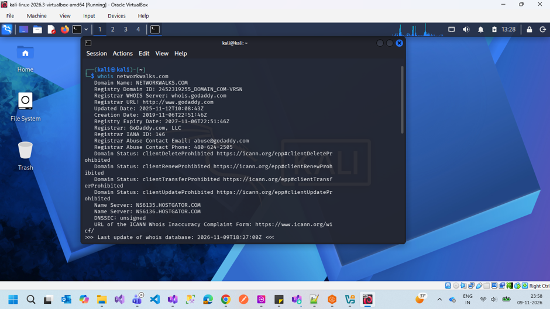
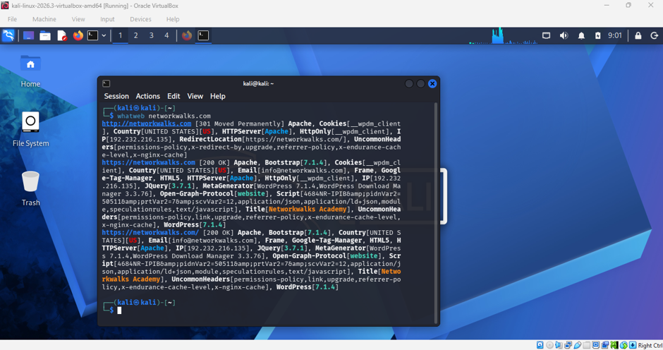
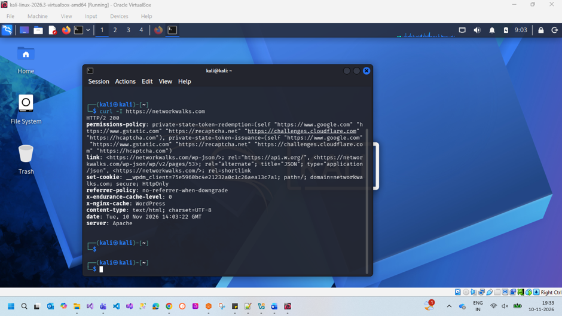
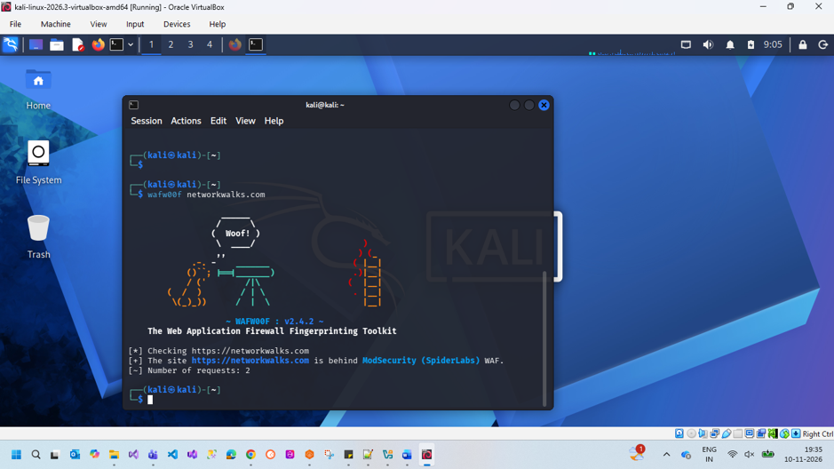
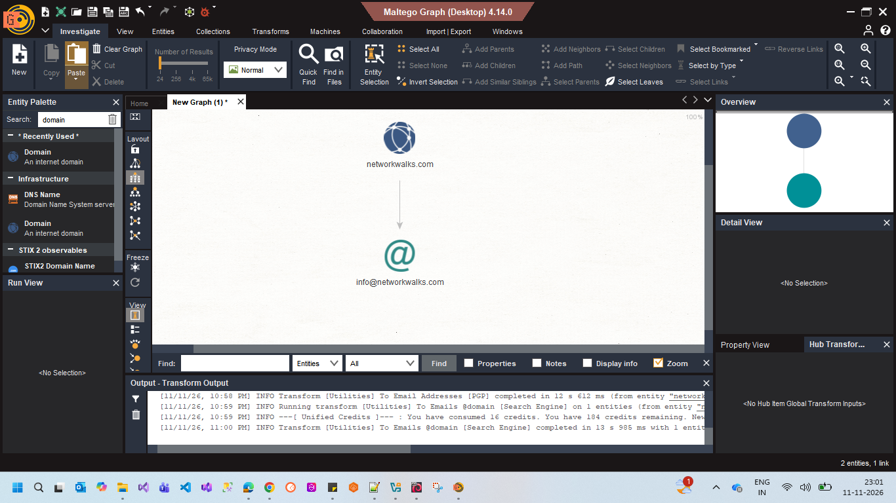

# 🛡️ Penetration Testing Report: Footprinting & Network Scanning

**W2-PM-FINAL | Cybersecurity | Networkwalks**

This repository documents my Week 2 project activities in footprinting, reconnaissance, OSINT and network scanning. It follows the reference repository's simple layout: a README, the formal report and a screenshots.

---

## 📋 Report Overview

| Field | Detail |
|---|---|
| Author | Pogula Harsha Sri |
| Program | Cybersecurity & Ethical Hacking – Networkwalks |
| Date | 12 November 2026 |
| Modules | W2-PM1, W2-PM2, W2-PM3, W2-PM4, W2-PM5 |
| Phases | Reconnaissance & Footprinting; Scanning & Network Discovery |

## 🎯 Scope of Activities

| Activity | Target / Scope | Tools / Method |
|---|---|---|
| W2-PM1 Footprinting | `networkwalks.com` | WHOIS, WhatWeb, Nslookup, cURL, WAFW00F, DNSRecon |
| W2-PM2 GHDB | GHDB / search-engine results | Google dorks and review of indexed information |
| W2-PM3 Maltego | `networkwalks.com` | Domain entity and authorized OSINT relationship mapping |
| W2-PM4 theHarvester | `microsoft.com` | Passive collection of public email addresses and subdomains |
| W2-PM5 Zenmap | Own LAN | Ping Scan and host discovery |


## 🗺️ The 5 Phases of a Penetration Test

| # | Phase | Status |
|---|---|---|
| 1 | Reconnaissance & Footprinting | Covered in PM1–PM4 |
| 2 | Scanning & Enumeration | Covered in PM5 |
| 3 | Gaining Access | Not part of this project |
| 4 | Maintaining Access | Not part of this project |
| 5 | Covering Tracks & Reporting | Reporting/documentation practiced |

## 🧰 Tools Used

| Tool | Purpose |
|---|---|
| WHOIS | Domain registration and name-server information |
| WhatWeb | Web technology fingerprinting |
| Nslookup | DNS name resolution |
| cURL | HTTP response-header inspection |
| WAFW00F | WAF detection |
| DNSRecon | DNS record enumeration |
| GHDB / Google Dorks | Search-engine reconnaissance |
| Maltego | Visual OSINT and entity relationship mapping |
| theHarvester | Public email and subdomain collection |
| Zenmap / Nmap | Host discovery and network scanning |

---

# 🔍 Phase 1: Footprinting & Reconnaissance

## 1. W2-PM1 – Footprinting with Multiple Kali Linux Tools

**Target:** `networkwalks.com`

```bash
whois networkwalks.com
whatweb networkwalks.com
nslookup networkwalks.com
curl -I https://networkwalks.com
wafw00f networkwalks.com
dnsrecon -d networkwalks.com
```

The module uses six tools to inspect domain registration, web technologies, DNS resolution, HTTP headers, WAF presence and DNS records.








## PM2 – Google Dorking and Google Hacking Database (GHDB)

### Objective
To understand how advanced Google search operators can be used to find publicly indexed information.

### Tools Used
- Google Search
- Google Hacking Database (GHDB)

### Practical Work

**1. Google Dorking**

Practiced advanced Google search operators to filter search results and identify specific information.

Examples:

```text
site:example.com
filetype:pdf site:example.com
intitle:"index of"
inurl:login
```


**2. Google Hacking Database (GHDB)**

Explored GHDB to understand different search queries used for identifying publicly indexed information.


### Learning Outcome
Learned how to use Google search operators and GHDB for information gathering and reconnaissance.

## PM3 – Footprinting Using Maltego

### Objective
To understand how Maltego can be used to visualize relationships between domains and other publicly available entities.

### Tool Used
- Maltego

### Practical Work

1. Installed and opened Maltego on Windows.
2. Created a new investigation graph.
3. Added `networkwalks.com` as the starting domain.
4. Explored available transforms.
5. Examined the relationships displayed in the graph.

**Findings:** 


### Observation
Maltego displayed relationships between the starting domain and the entities returned by the selected transforms.

### Learning Outcome
Learned how to create investigation graphs, execute transforms and visualize relationships during OSINT investigations.


## PM4 – Footprinting Using theHarvester

### Objective
To collect publicly available information associated with a domain using theHarvester.

### Tool Used
- theHarvester

### Practical Work

**1. Checking Available Options**

```bash
theHarvester -h
```

Used to view the available commands and options.

**2. Information Gathering**

```bash
theHarvester -d example.com -b baidu
```

Used to search for publicly available information associated with the specified domain using the selected data source.

**3. Reviewing Results**

Examined the output for discovered email addresses, subdomains and hostnames.


### Learning Outcome
Learned how to use theHarvester for OSINT-based information gathering and understand the information returned by different data sources.


---

# 📡 Phase 2: Scanning with Zenmap

## 5. W2-PM5 – Host Discovery with Zenmap

### Objective

To understand network scanning and identify active hosts on a network using Zenmap (Nmap GUI).

### What I Learned

- Learned how to identify network configuration details using the Windows `ipconfig` command.
- Understood IP addresses, subnet masks, LAN subnets, and default gateways.
- Learned how to use Zenmap's **Ping Scan** profile to discover active hosts on a network.
- Understood how Nmap identifies live hosts and displays scan results.
- Learned how to identify IP addresses, MAC addresses, and vendor information from scan results.
- Explored Zenmap's **Topology** feature to visualize discovered hosts and their relationships within a network.
- Learned how to save scan results and network topology for documentation and analysis.
- Understood the importance of network discovery in identifying devices connected to a network.

### Tools Used

- Zenmap (Nmap GUI)
- Nmap
- Windows Command Prompt (`ipconfig`)

### Key Takeaways

This practical helped me understand the basics of network discovery, host identification, and network topology visualization. I also learned how network scanning can assist security professionals in understanding network infrastructure and identifying active devices.


---

## ⚖️ Risk Analysis

| Finding | Evidence | Potential impact |
|---|---|---|
| Public web technology information | PM1 outputs | Helps build a target profile; versions require validation |
| Publicly indexed information | PM2 results | May reveal unintended exposure; verify only within authorized scope |
| Domain-related entities | PM3 graph | Helps organize public information |
| Public emails and subdomains | PM4 output | Expands an organization's public footprint |
| Multiple live LAN hosts | PM5 Ping Scan | Unknown devices should be identified by the network owner |

These are observations, not confirmed vulnerabilities. No exploitation or vulnerability validation is claimed.

## ✅ Recommendations

- Review public-facing technology information and keep software updated.
- Review DNS records and HTTP response headers periodically.
- Keep OSINT collection within the approved scope.
- Never access or publish private camera feeds, credentials or sensitive data.
- Verify devices discovered on the local network.
- Maintain an updated inventory of authorized devices.
- Save scan outputs and network topology evidence.
- Remove credentials, tokens and personal account details from screenshots.

## 💡 What I Learned

- Each footprinting tool reveals a different part of a domain's public information.
- Search operators can locate information indexed by search engines.
- Maltego helps visualize relationships between entities.
- theHarvester collects public email and subdomain information.
- Zenmap simplifies host discovery and scan-result review.
- A finding is not automatically a vulnerability; observations need validation.
- Authorization and scope are essential before reconnaissance or scanning.


## 👤 Author

**Harsha Sri**  
Cybersecurity & Ethical Hacking – Networkwalks

*Educational project documentation. Perform security testing only with appropriate authorization.*
